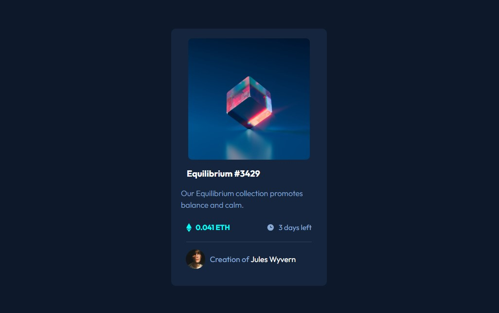

# Frontend Mentor - NFT Preview Card Component Solution

This is my solution to the [NFT Preview Card Component challenge on Frontend Mentor](https://www.frontendmentor.io/challenges/nft-preview-card-component-SbdUL_w0U).

## Table of Contents

- [Overview](#overview)
  - [The Challenge](#the-challenge)
  - [Screenshot](#screenshot)
  - [Links](#links)
- [My Process](#my-process)
  - [Built With](#built-with)
  - [What I Learned](#what-i-learned)
  - [Continued Development](#continued-development)
  - [Useful Resources](#useful-resources)
- [Author](#author)
- [Acknowledgments](#acknowledgments)

## Overview

### The Challenge

Users should be able to:

- View the layout on different screen sizes.
- See hover states for interactive elements.

### Screenshot

### Links

- Solution URL: https://www.frontendmentor.io/solutions/nft-card-30bx1HsVFd
- Live Site URL: https://abdurraheem25.github.io/nft-card/

## My Process

### Built With

- Semantic HTML5 markup
- CSS3
- Flexbox
- CSS pseudo-elements
- Responsive web design

### What I Learned

While working on this project, I practised creating a responsive card layout and implementing hover effects using CSS.

I learned how to use `position: relative` and `position: absolute` to position an overlay over an image. I also used the `::after` pseudo-element to create the cyan image overlay and display the eye icon.

I improved my understanding of the `:hover` selector, `opacity`, and `transition` properties to create interactive effects for the NFT image, title, and creator's name.

### Continued Development

I want to continue improving my CSS layout skills, responsive design, and ability to create interactive components independently. I also plan to practise more advanced CSS effects in future projects.

### Useful Resources

- [Frontend Mentor](https://www.frontendmentor.io/) - Provided the challenge design and requirements.
- [MDN Web Docs](https://developer.mozilla.org/en-US/docs/Web/CSS) - A reference for CSS properties and selectors.

## Author

- Frontend Mentor: https://www.frontendmentor.io/profile/abdurraheem25

## Acknowledgments

Thanks to Frontend Mentor for providing the challenge and design resources that helped me practise my frontend development skills.
